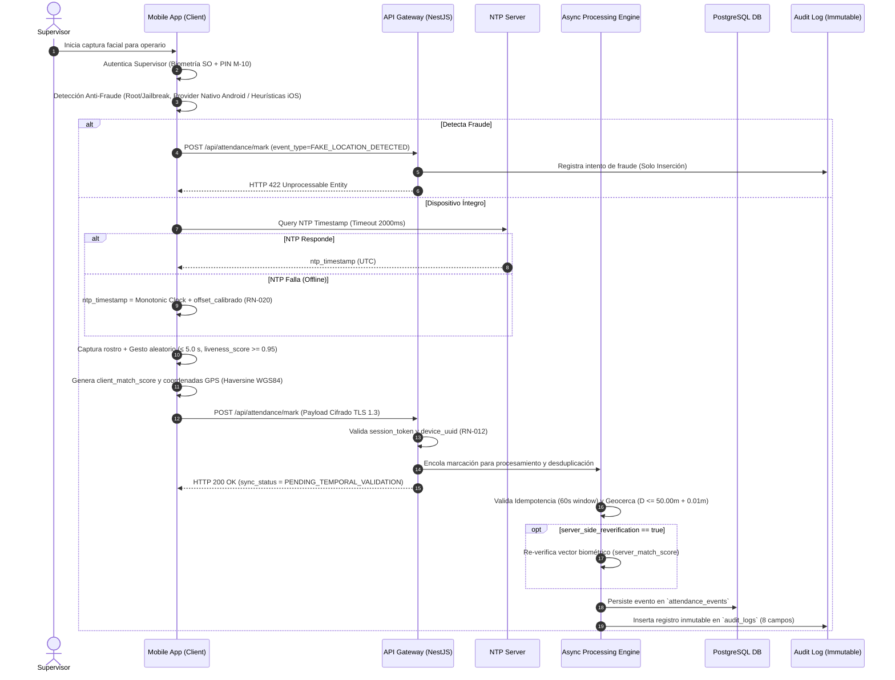
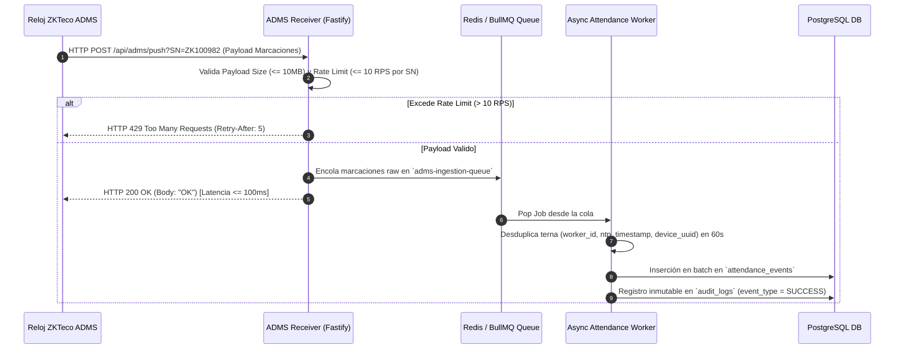
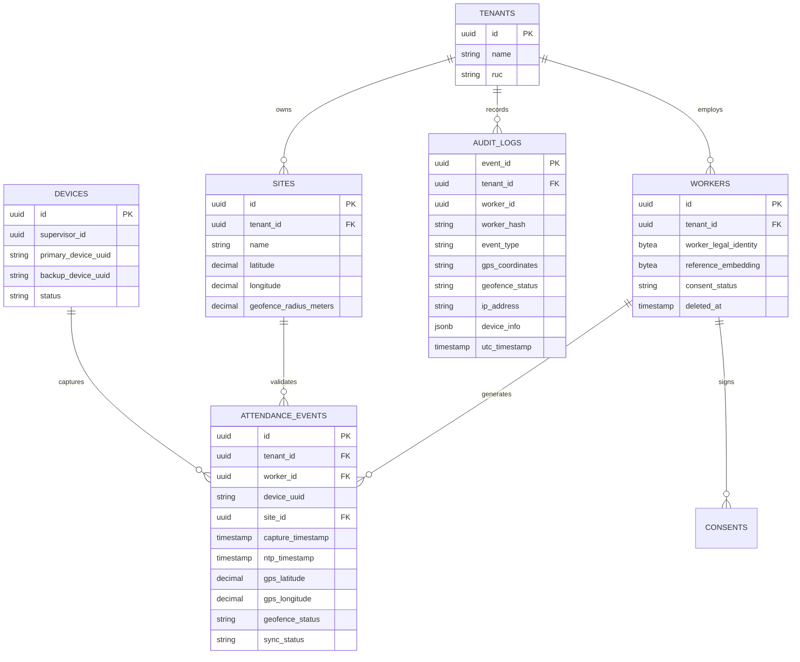

# Arquitectura Técnica — Módulo Operativo y Control de Asistencia Omnicanal

**Versión:** 1.0.1
**Fecha:** 11 de Noviembre de 2026
**Estado:** Aprobado para Diseño Detallado
**Cambios v1.0.1:** §3.4 referencia RN-021-A; §3.5 nota de saturación cliente; Anexo A añade RN-021-A (QA-VAL-002).
**Referencias:** Spec Pack v2.2.2 (`00-constitucion.md`, `01-project-brief.md`, `02-alcance.md`, `03-reglas-de-negocio.md`, `04-glosario.md`, `05-preguntas-abiertas.md`, `06-user-stories.md`).

---

## 1. Overview del Sistema

### 1.1 Descripción
El **Módulo Operativo y Control de Asistencia Omnicanal** es un ecosistema distribuido de alto rendimiento y resiliencia para el registro, validación y auditoría inmutable de asistencia laboral en Perú. Diseñado para operar sobre una arquitectura híbrida desacoplada, integra la captura síncrona/asíncrona mediante dispositivos hardware biométricos **ZKTeco (ADMS Push)** en sedes fijas y aplicaciones móviles nativas/híbridas (**Android/iOS**) en celulares corporativos operados por Supervisores de Ronda para personal itinerante.

El sistema garantiza una latencia de ingestion p95 $\le 100\text{ ms}$ a $500\text{ RPS}$ en el canal hardware y p95 $\le 500\text{ ms}$ a $200\text{ RPS}$ en el canal móvil. Incorpora mecanismos avanzados de protección anti-fraude (*Liveness Detection*, heurísticas de consenso multi-muestra para detección de *Fake GPS*, verificación de firma de *kernel* root/jailbreak y sello temporal de red NTP), un esquema *Offline-First* con cifrado backed-by-hardware, y cumplimiento estricto de la Ley N.° 29733 de Protección de Datos Personales mediante *Crypto-Shredding* de revocación inmediata de clave AES-256 y trazabilidad de identidad verificada (RN-037).

### 1.2 Diagrama de Arquitectura de Alto Nivel
```mermaid
flowchart TB
    subgraph Clients["Capa de Clientes y Terminales"]
        ZKTeco["Hardware ZKTeco (ADMS Push)"]
        MobileApp["App Móvil Supervisor (Android 8.0+ / iOS 14+)"]
        DashboardUI["Dashboard Web Monitoreo (Next.js / Leaflet)"]
    end

    subgraph Ingestion["Capa de Ingesta e Integración (API Gateway / Fastify)"]
        AdmsReceiver["ADMS Push Receiver Endpoint (/api/adms/push)"]
        MobileApiGateway["Mobile API Gateway (/api/attendance/mark)"]
        DashboardApiGateway["Dashboard API Gateway (/api/dashboard/attendance)"]
    end

    subgraph AsyncQueue["Capa de Procesamiento Asíncrono"]
        RedisQueue[("Redis Store / BullMQ Queues")]
        Workers["Async Attendance & Fraud Workers"]
    end

    subgraph CoreBackend["Capa Core Backend (NestJS Services)"]
        AttendanceCore["Attendance Core Service"]
        BiometricEngine["Biometric Verification Service (NIST FRVT)"]
        GeoService["Geofence Evaluator Service (Haversine WGS84)"]
        DeviceService["Device Binding & Security Service"]
        ComplianceKMS["Compliance, ARCO & KMS Service"]
    end

    subgraph DataStorage["Capa de Persistencia y Seguridad"]
        PostgresDB[("PostgreSQL 15+ (LUKS + PostGIS + pg_trgm)")]
        HardwareKMS["Cloud KMS / Vault (AES-256 Keys)"]
        NtpCluster["Servidores NTP Corporativos (UTC Timestamp)"]
    end

    ZKTeco -->|HTTP POST ADMS / TLS 1.3| AdmsReceiver
    MobileApp -->|HTTPS / TLS 1.3| MobileApiGateway
    DashboardUI -->|HTTPS / Session Token| DashboardApiGateway

    AdmsReceiver -->|Push Job | p95 <= 100ms| RedisQueue
    MobileApiGateway -->|Validate & Enqueue| RedisQueue

    RedisQueue --> Workers
    Workers --> AttendanceCore
    Workers --> BiometricEngine
    Workers --> GeoService

    MobileApiGateway --> DeviceService
    DashboardApiGateway --> AttendanceCore
    
    AttendanceCore --> PostgresDB
    ComplianceKMS --> HardwareKMS
    ComplianceKMS --> PostgresDB

    MobileApp <.->|Monotonic Clock Calibration| NtpCluster
    MobileApiGateway <.->|Primary Time Source| NtpCluster
```

### 1.3 Principios de Diseño Alineados a la Constitución (`00-constitucion.md`)

| Principio | Título | Alineación Arquitectónica |
|---|---|---|
| **PRINCIPIO-001** | Idioma Estándar | Identificadores técnicos en **Inglés** (`worker_id`, `ntp_timestamp`, `device_uuid`, `geofence_status`). UI y documentación en **Español Neutro**. |
| **PRINCIPIO-002** | Dashboard GPS sin Login Tradicional | Acceso al mapa mediante `session_token` firmado (TTL $\le 12\text{ h}$) enlazado al entorno autorizado. Renderiza pines y radio de $50\text{ m}$. |
| **PRINCIPIO-003** | Cifrado y Ley N.° 29733 | Cifrado AES-256 para vectores/fotos faciales. TLS 1.3 obligatorio en tránsito. Cifrado local móvil respaldado por hardware (KeyStore/Keychain). |
| **PRINCIPIO-004** | Integración ZKTeco Desacoplada | Ingesta asíncrona vía BullMQ/Redis. Rate limit de $10\text{ RPS}$ por dispositivo. Desduplicación idempotente en ventana de $60\text{ s}$. |
| **PRINCIPIO-005** | Marcación Facial Anti-Fraude | *Liveness* activo ($score \ge 0.95$), bloqueo de *Mock Location* (Android Provider nativo / Heurísticas de consenso iOS), NTP primario. |
| **PRINCIPIO-006** | Operación *Offline-First* | Persistencia local cifrada ($\le 5,000$ reg o $200\text{ MB}$). Sincronización en segundo plano con backoff exponencial y banner persistente. |
| **PRINCIPIO-007** | Restricciones Agentes IA | Ningún agente de IA puede alterar esquemas SQL, deshabilitar pruebas o incluir claves/datos reales en el repositorio. |
| **PRINCIPIO-008** | Suite E2E y Datos Sintéticos | Entorno E2E determinista con emuladores de ubicación y datos de personal $100\%$ sintéticos (Mocks). Cobertura $\ge 80\%$ Backend, $\ge 70\%$ App. |
| **PRINCIPIO-009** | Auditabilidad Inmutable | Tabla `audit_logs` de solo inserción con los 8 campos obligatorios y enumerado cerrado de `event_type`. |
| **PRINCIPIO-010** | Cumplimiento ARCO y Retención | Verificación de identidad ARCO (RN-037), *Crypto-Shredding* con revocación inmediata de clave AES-256 en KMS a las 24 h y preservación de `worker_hash` por 5 años. |

---

## 2. Componentes Principales

### 2.1 Mobile Application (`MobileApp`)
* **Responsabilidad:** Captura de asistencia móvil, validación activa de prueba de vida (*liveness*), recolección de métricas GPS, heurísticas anti-fraude en cliente (*Mock Location*, root/jailbreak), almacenamiento cifrado local *Offline-First*, sincronización en segundo plano con banner de pendientes.
* **Tecnología:** React Native 0.72+ / Capacitor sobre TypeScript; SQLite/MMKV cifrado con hardware KeyStore (Android) / Keychain (iOS); SDK biométrico nativo NIST FRVT.
* **Épicas Cubiertas:** E-01, E-02, E-03, E-04, E-06, E-08, E-10.
* **HUs Cubiertas:** HU-001, HU-002, HU-003, HU-004, HU-005, HU-006, HU-007, HU-008, HU-010, HU-013, HU-016, HU-025, HU-026.
* **Reglas Atendidas:** RN-001A, RN-001B, RN-001C, RN-001D, RN-002, RN-002-A/B/C, RN-003, RN-003-A-1…A-6, RN-003-B/C, RN-004, RN-005, RN-005-G, RN-005-H, RN-012, RN-012-A/B, RN-019, RN-020, RN-021.
* **Interfaces Expuestas / Consumidas:**
  * Consume: `POST /api/attendance/mark`, `POST /api/devices/{uuid}/activate-backup`.
  * Expone: Interfaz de usuario nativa, eventos del SO para sincronización en segundo plano (`WorkManager` / `BGTaskScheduler`).

### 2.2 ADMS Ingestion Receiver (`AdmsReceiver`)
* **Responsabilidad:** Endpoint de alta velocidad para la ingesta síncrona de marcaciones procedentes de terminales físicas ZKTeco mediante protocolo ADMS Push (HTTP/HTTPS). Retorna respuesta inmediata en $p95 \le 100\text{ ms}$ y desacopla el procesamiento a la cola de mensajería.
* **Tecnología:** NestJS / Fastify de alta densidad, rate-limiter de memoria Redis, validadores de tamaño de payload HTTP.
* **Épicas Cubiertas:** E-07.
* **HUs Cubiertas:** HU-012.
* **Reglas Atendidas:** RN-011, RN-011-A, RN-011-B, RN-018.
* **Interfaces Expuestas / Consumidas:**
  * Expone: `POST /api/adms/push`.
  * Publica: Eventos raw en cola `adms-ingestion-queue` en Redis/BullMQ.

### 2.3 Async Processing Engine (`AsyncProcessingEngine`)
* **Responsabilidad:** Consumo asíncrono de eventos de la cola BullMQ. Desduplicación de marcaciones en ventana de $60\text{ s}$, evaluación geodésica, verificación de vectores biométricos en servidor, emisión de alertas operativas y escritura inmutable en el log de auditoría.
* **Tecnología:** Node.js (NestJS Microservices), Redis 7+, BullMQ 5.0+.
* **Épicas Cubiertas:** E-01, E-02, E-03, E-04, E-07, E-12.
* **HUs Cubiertas:** HU-001, HU-002, HU-006, HU-007, HU-012, HU-018, HU-021.
* **Reglas Atendidas:** RN-001C, RN-002, RN-006, RN-011, RN-016, RN-017, RN-017-A, RN-018, RN-019.
* **Interfaces Expuestas / Consumidas:**
  * Consume: Colas BullMQ (`adms-ingestion-queue`, `mobile-sync-queue`).
  * Emite: Eventos a PostgreSQL y WebSockets de Alertas Operativas.

### 2.4 Attendance Core Service (`AttendanceCore`)
* **Responsabilidad:** Lógica central del dominio de asistencia: gestión de trabajadores, sedes (coordenadas WGS84), asignación de mallas operativas, consolidación de tareos para pre-planilla, evaluación de expiración offline de 72 h y derivación a aprobación manual.
* **Tecnología:** NestJS Framework, TypeORM / Prisma, PostgreSQL 15+ con extensión PostGIS.
* **Épicas Cubiertas:** E-02, E-06, E-13, E-14.
* **HUs Cubiertas:** HU-002, HU-010, HU-011, HU-019, HU-020, HU-022.
* **Reglas Atendidas:** RN-002, RN-002-B, RN-010, RN-016, RN-017, RN-017-A, RN-019, RN-030-D.
* **Interfaces Expuestas / Consumidas:**
  * Consume: Servicio de Persistencia PostgreSQL.
  * Expone: Servicios internos de dominio para Ingesta y Dashboard.

### 2.5 Monitoring Dashboard (`DashboardUI`)
* **Responsabilidad:** Interfaz web interactiva para el Administrador de Operaciones. Visualización de marcaciones sobre mapa con superposición del radio de geocerca ($50\text{ m}$), filtrado por rango de fechas/trabajador, panel de alertas operativas en tiempo real y exportación de reportes auditables.
* **Tecnología:** React 18 / Next.js 14 App Router, Leaflet / OpenStreetMap, Tailwind CSS, WebSockets (`socket.io-client`).
* **Épicas Cubiertas:** E-05, E-12, E-14.
* **HUs Cubiertas:** HU-009, HU-018, HU-020.
* **Reglas Atendidas:** RN-007, RN-008, RN-013, RN-016.
* **Interfaces Expuestas / Consumidas:**
  * Consume: `GET /api/dashboard/attendance`, WebSockets de Alertas Operativas.

### 2.6 Compliance & KMS Service (`ComplianceKMSService`)
* **Responsabilidad:** Gestión de consentimiento informado versionado, atención de solicitudes ARCO con verificación de identidad (RN-037), administración del ciclo de vida de llaves simétricas AES-256 en KMS, ejecución de *Crypto-Shredding* (revocación inmediata de llave a las 24 h y purga física a 30 días) y generación de constancias de pérdida de asistencia.
* **Tecnología:** NestJS, AWS KMS / HashiCorp Vault SDK, WebCrypto API.
* **Épicas Cubiertas:** E-08, E-09.
* **HUs Cubiertas:** HU-014, HU-015, HU-023, HU-024.
* **Reglas Atendidas:** RN-012-C, RN-012-D, RN-030, RN-030-A/B/C/D, RN-031, RN-032, RN-033, RN-033-A…E, RN-034, RN-035, RN-035-A/B, RN-036, RN-036-A…D, RN-037.
* **Interfaces Expuestas / Consumidas:**
  * Expone: `POST /api/arco/operations`.
  * Interactúa: Cloud KMS / Vault API y PostgreSQL Database.

---

### 2.7 Tabla de Trazabilidad de Componentes

| Componente | Épicas Cubiertas | Historias de Usuario (HUs) | Reglas de Negocio (RN) Atendidas |
|---|---|---|---|
| **Mobile Application** | E-01, E-02, E-03, E-04, E-06, E-08, E-10 | HU-001, HU-002, HU-003, HU-004, HU-005, HU-006, HU-007, HU-008, HU-010, HU-013, HU-016, HU-025, HU-026 | RN-001A/B/C/D, RN-002, RN-002-A/B/C, RN-003, RN-003-A-1…A-6, RN-003-B/C, RN-004, RN-005, RN-005-G, RN-005-H, RN-012, RN-012-A/B, RN-019, RN-020, RN-021 |
| **ADMS Ingestion Receiver** | E-07 | HU-012 | RN-011, RN-011-A, RN-011-B, RN-018 |
| **Async Processing Engine** | E-01, E-02, E-03, E-04, E-07, E-12 | HU-001, HU-002, HU-006, HU-007, HU-012, HU-018, HU-021 | RN-001C, RN-002, RN-006, RN-011, RN-016, RN-017, RN-017-A, RN-018, RN-019 |
| **Attendance Core Service** | E-02, E-06, E-13, E-14 | HU-002, HU-010, HU-011, HU-019, HU-020, HU-022 | RN-002, RN-002-B, RN-010, RN-016, RN-017, RN-017-A, RN-019, RN-030-D |
| **Monitoring Dashboard** | E-05, E-12, E-14 | HU-009, HU-018, HU-020 | RN-007, RN-008, RN-013, RN-016 |
| **Compliance & KMS Service** | E-08, E-09 | HU-014, HU-015, HU-023, HU-024 | RN-012-C, RN-012-D, RN-030, RN-030-A…D, RN-031…RN-035, RN-035-A/B, RN-036…D, RN-037 |

---

### 2.8 Interfaces entre Componentes

```
[MobileApp] ------ HTTPS / TLS 1.3 (JSON) ------> [MobileApiGateway / NestJS]
[ZKTeco] --------- HTTP POST ADMS --------------> [AdmsReceiver / Fastify]
[AdmsReceiver] --- BullMQ Producer (Redis Protocol) -> [Redis Store]
[Redis Store] ---- BullMQ Consumer -------------> [AsyncProcessingEngine]
[AsyncEngine] ---- TypeORM / SQL ---------------> [PostgreSQL 15+]
[ComplianceKMS] -- REST API / KMS SDK ----------> [Cloud KMS / Vault]
[DashboardUI] ---- HTTPS / WebSocket -----------> [DashboardApiGateway]
```

---

### 2.9 Diagramas de Secuencia de Flujos Críticos

#### Flujo A: Marcación Facial Móvil End-to-End


#### Flujo B: Recepción e Ingesta ZKTeco ADMS


---

## 3. Modelo de Datos

### 3.1 Entidades y Atributos

#### `tenants`
* `id`: `UUID` (PK, Not Null)
* `name`: `VARCHAR(150)` (Not Null)
* `ruc`: `VARCHAR(11)` (Unique, Not Null)
* `created_at`: `TIMESTAMPTZ` (Default UTC)

#### `sites` (Sedes Clientes)
* `id`: `UUID` (PK, Not Null)
* `tenant_id`: `UUID` (FK -> `tenants.id`, Not Null)
* `name`: `VARCHAR(200)` (Not Null)
* `latitude`: `DECIMAL(10, 8)` (Not Null, WGS84)
* `longitude`: `DECIMAL(11, 8)` (Not Null, WGS84)
* `geofence_radius_meters`: `DECIMAL(5, 2)` (Default 50.00)
* `is_active`: `BOOLEAN` (Default True)

#### `workers` (Trabajadores / Operarios)
* `id`: `UUID` (PK, Not Null)
* `tenant_id`: `UUID` (FK -> `tenants.id`, Not Null)
* `worker_legal_identity`: `BYTEA` (Not Null, AES-256 Cifrado: DNI, Nombres) — **Nivel: Confidencial**
* `reference_embedding`: `BYTEA` (Nullable, AES-256 Cifrado: Vector Biométrico) — **Nivel: Biométrico Crítico**
* `consent_status`: `VARCHAR(30)` (Enum: `PENDING_CONSENT`, `CONSENTED`, `REVOKED`)
* `deleted_at`: `TIMESTAMPTZ` (Nullable, Marca borrado lógico ARCO)

#### `devices` (Dispositivos Registrados)
* `id`: `UUID` (PK, Not Null)
* `supervisor_id`: `UUID` (Not Null)
* `primary_device_uuid`: `VARCHAR(64)` (Unique, Not Null)
* `backup_device_uuid`: `VARCHAR(64)` (Unique, Nullable)
* `status`: `VARCHAR(30)` (Enum: `AUTHORIZED`, `UNAUTHORIZED`, `TEMPORARILY_BLOCKED`, `LOST_OR_DESTROYED`)

#### `attendance_events` (Marcaciones)
* `id`: `UUID` (PK, Not Null)
* `tenant_id`: `UUID` (FK -> `tenants.id`, Not Null)
* `worker_id`: `UUID` (FK -> `workers.id`, Not Null)
* `device_uuid`: `VARCHAR(64)` (Not Null)
* `site_id`: `UUID` (FK -> `sites.id`, Nullable)
* `capture_timestamp`: `TIMESTAMPTZ` (Not Null, UTC)
* `ntp_timestamp`: `TIMESTAMPTZ` (Not Null, UTC)
* `gps_latitude`: `DECIMAL(10, 8)` (Not Null)
* `gps_longitude`: `DECIMAL(11, 8)` (Not Null)
* `gps_accuracy_meters`: `DECIMAL(6, 2)` (Not Null)
* `geofence_status`: `VARCHAR(30)` (Enum: `INSIDE_GEOFENCE`, `OUTSIDE_GEOFENCE`, `UNCERTAIN_GEOLOCATION`)
* `sync_status`: `VARCHAR(30)` (Enum: `PENDING_SYNC`, `PENDING_TEMPORAL_VALIDATION`, `REQUIRES_MANUAL_APPROVAL`, `SYNCHRONIZED`)

#### `audit_logs` (Registro Inmutable — PRINCIPIO-009)
* `event_id`: `UUID` (PK, Not Null, Unique)
* `tenant_id`: `UUID` (FK -> `tenants.id`, Not Null)
* `worker_id`: `UUID` (Nullable, Real o Hash por ARCO)
* `worker_hash`: `VARCHAR(64)` (Nullable, Hash Criptográfico tras Crypto-Shredding)
* `event_type`: `VARCHAR(50)` (Enum Restringido PRINCIPIO-009, Not Null)
* `gps_coordinates`: `VARCHAR(50)` (Not Null)
* `geofence_status`: `VARCHAR(30)` (Not Null)
* `ip_address`: `VARCHAR(45)` (Not Null)
* `device_info`: `JSONB` (Not Null: `{device_uuid, os_version, app_version, model}`)
* `utc_timestamp`: `TIMESTAMPTZ` (Not Null, Default UTC)

---

### 3.2 Diagrama Entidad-Relación (ERD)


---

### 3.3 Estrategia de Cifrado y Seguridad

1. **Cifrado en Reposo (Database & Files):**
   * Vectores biométricos (`reference_embedding`) e identidades legales (`worker_legal_identity`) cifrados individualmente con **AES-256-GCM** utilizando llaves gestionadas en Cloud KMS.
   * Cifrado transparente de volumen de disco PostgreSQL mediante **LUKS / Cloud KMS AES-256**.
2. **Cifrado en Tránsito:**
   * **TLS 1.3** estricto en todas las conexiones HTTP (`HTTPS`) y WebSockets (`WSS`). Conexiones TLS 1.2 son rechazadas por el API Gateway.
3. **Almacenamiento Local Móvil:**
   * Persistencia en cliente cifrada en reposo respaldada por hardware nativo (**Android Keystore System** / **iOS Keychain**).

---

### 3.4 Retención y Crypto-Shredding (RN-033, RN-035)

```
[Solicitud ARCO / Cese Laboral]
             │
             ▼ (24 Horas)
┌──────────────────────────────────────────┐
│ 1. Set `deleted_at = NOW()` en Vector    │
│ 2. Revocación Inmediata de Clave AES-256 │
│    en KMS (RN-033-B) [Atómica]           │
└──────────────────────────────────────────┘
             │
             ▼ (30 Días)
┌──────────────────────────────────────────┐
│ 3. Borrado Físico de Datos Cifrados      │
│    (RN-033-C)                            │
│ 4. Anonimización Audit Log con           │
│    `worker_hash = HMAC(worker_id, salt)` │
└──────────────────────────────────────────┘
             │
             ▼ (5 Años)
┌──────────────────────────────────────────┐
│ 5. Retención de Identidad Legal Mínima   │
│    y Logs de Auditoría para SUNAT/MTPE   │
└──────────────────────────────────────────┘
```

**Saturación local (RN-021 / RN-021-A):**

[Captura sin red] ──> [Cifrado Local Hardware] ──> [Storage Local (IndexedDB/MMKV)]
│
┌──────────────────────────────┤
▼ ▼
registros_pendientes < 4,000 registros_pendientes >= 4,000
AND uso_disco_mb < 160 OR uso_disco_mb >= 160
│ │
▼ ▼
Banner ámbar (RN-005-G) Banner rojo parpadeante (RN-021-A)
"3 pendientes de sync" "⚠️ Almacenamiento local al 81 %"
│ │
│ ▼
│ Forzar reintento sync si hay red
│ │
▼ ▼
Sincronización normal Si N >= 5,000 OR MB >= 200 → Bloqueo (RN-021)
---

### 3.5 Estrategia de Índices SQL (RNF-002, RNF-003)

Para garantizar un rendimiento del Dashboard de Monitoreo $p95 \le 1.5\text{ s}$ con 10,000 marcaciones (RNF-002) y soporte de ingesta ZKTeco a $500\text{ RPS}$ (RNF-003):

```sql
-- Índice Compuesto para Filtro por Rango de Fechas y Tenant en Dashboard
CREATE INDEX idx_attendance_tenant_timestamp 
ON attendance_events (tenant_id, ntp_timestamp DESC, worker_id);

-- Índice Espacial PostGIS para Consultas Geodésicas Rápidas
CREATE INDEX idx_sites_spatial_location 
ON sites USING GIST (ST_SetSRID(ST_MakePoint(longitude, latitude), 4326));

-- Índice Trigram GIN sobre Nombres no Sensibles (Búsqueda por Texto)
CREATE INDEX idx_sites_name_trgm 
ON sites USING GIN (name gin_trgm_ops);

-- Índice B-Tree de Solo Inserción para Auditoría Inmutable
CREATE INDEX idx_audit_logs_event_type_timestamp 
ON audit_logs (tenant_id, utc_timestamp DESC, event_type);
```

---

## 4. API Contracts

### 4.1 POST `/api/attendance/mark`
* **Descripción:** Registra u opera una marcación de asistencia enviada por la App Móvil.
* **Épicas:** E-01, E-02, E-03, E-04.
* **Autenticación:** Bearer Token (`session_token` del Supervisor). Rate Limit: $20\text{ req/min}$ por supervisor.

#### Request Headers
```http
Authorization: Bearer <session_token>
Content-Type: application/json
X-Device-UUID: 550e8400-e29b-41d4-a716-446655440000
```

#### Request Body Schema (TypeScript Interface)
```typescript
interface MarkAttendanceRequest {
  worker_id: string; // UUID v4
  capture_timestamp: string; // ISO8601 UTC
  ntp_timestamp: string; // ISO8601 UTC
  offset_calibrated_ms: number;
  gps: {
    latitude: number;
    longitude: number;
    accuracy_meters: number;
    is_mock_provider: boolean;
  };
  liveness: {
    score: number; // >= 0.95
    gesture_type: 'DOUBLE_BLINK' | 'LEFT_WINK' | 'RIGHT_WINK' | 'HEAD_TILT';
    duration_ms: number; // <= 5000
  };
  client_match_score: number; // >= 0.92
  face_embedding_base64?: string; // Transmitido solo si server_side_reverification == true
}
```

#### Response Body Schema (200 OK)
```json
{
  "status": "SUCCESS",
  "event_id": "c39a2d80-87b6-4e55-89b1-123456789abc",
  "geofence_status": "INSIDE_GEOFENCE",
  "sync_status": "SYNCHRONIZED",
  "server_match_score": 0.94,
  "processed_at": "2026-11-10T14:30:00.120Z"
}
```

#### Respuestas de Error
* `401 Unauthorized`: Token de sesión inválido o expirado.
* `403 Forbidden`: `device_uuid` no autorizado o revocación de consentimiento (`PENDING_CONSENT`).
* `422 Unprocessable Entity`: Fraude detectado (`FAKE_LOCATION_DETECTED`, `JAILBREAK_DETECTED`, `LIVENESS_FAILED`).
* `503 Service Unavailable`: Servidores NTP inaccesibles y sin offset calibrado válido (RN-020-A).

---

### 4.2 POST `/api/adms/push`
* **Descripción:** Endpoint de ingesta de marcaciones para relojes biométricos ZKTeco mediante protocolo ADMS Push.
* **Épicas:** E-07.
* **Autenticación:** Token en URL / Serial Number asignado (`SN`). Rate Limit: $10\text{ RPS}$ por `serial_number`.

#### Request Parameters (Query & Body)
```http
POST /api/adms/push?SN=ZK9500129384&table=ATTLOG HTTP/1.1
Host: api.empresa.pe
Content-Type: text/plain
```
*Payload Body:* Registros tabulares raw emitidos por el firmware ZKTeco.

#### Response Body (200 OK)
```text
OK
```
*(Respuesta en texto plano en $p95 \le 100\text{ ms}$, cuerpo `"OK"` exigido por ADMS).*

#### Respuestas de Error
* `413 Payload Too Large`: Payload $> 10\text{ MB}$ o $> 5,000$ registros (`max_records_per_request = 5000`).
* `429 Too Many Requests`: Excede $10\text{ RPS}$ para el `SN` especifico (`Retry-After: 5`).

---

### 4.3 GET `/api/dashboard/attendance`
* **Descripción:** Obtiene marcaciones para renderizado en el mapa interactivo del Dashboard.
* **Épicas:** E-05, E-12.
* **Autenticación:** Signed Session Token.

#### Request Parameters
```http
GET /api/dashboard/attendance?start_date=2026-11-01T00:00:00Z&end_date=2026-11-10T23:59:59Z&worker_id=c39a2d80-87b6-4e55-89b1-123456789abc HTTP/1.1
Authorization: Bearer <dashboard_session_token>
```

#### Response Body Schema (200 OK)
```json
{
  "total_records": 1,
  "data": [
    {
      "event_id": "c39a2d80-87b6-4e55-89b1-123456789abc",
      "worker_id": "w-789",
      "worker_full_name": "Juan Pérez",
      "site_id": "site-456",
      "site_name": "Sede San Isidro",
      "site_centroid": { "latitude": -12.093100, "longitude": -77.036500 },
      "geofence_radius_meters": 50.00,
      "captured_location": { "latitude": -12.093120, "longitude": -77.036510 },
      "distance_meters": 2.45,
      "geofence_status": "INSIDE_GEOFENCE",
      "pin_color": "GREEN",
      "timestamp_utc": "2026-11-10T14:30:00.000Z"
    }
  ]
}
```

---

### 4.4 POST `/api/arco/operations`
* **Descripción:** Atiende y procesa solicitudes de derechos ARCO con verificación previa de identidad (RN-037).
* **Épicas:** E-09.
* **Autenticación:** Bearer Token / OTP + Firma Digital (Ley N.° 27269).

#### Request Body Schema
```json
{
  "request_type": "CANCELLATION",
  "worker_id": "w-789",
  "identity_verification": {
    "digital_signature_token": "sig_pkg_987123",
    "otp_code": "482910",
    "verification_biometric_match_score": 0.96
  }
}
```

#### Response Body Schema (200 OK)
```json
{
  "status": "PROCESSED",
  "request_id": "arco-req-001",
  "action_taken": "CRYPTO_SHRED_INITIATED",
  "deleted_at": "2026-11-11T14:30:00.000Z",
  "key_revocation_status": "REVOKED_IMMEDIATELY",
  "physical_purge_scheduled_at": "2026-12-10T14:30:00.000Z"
}
```

#### Error Response
* `401 Unauthorized`: No superó la verificación de identidad (`event_type = ARCO_IDENTITY_UNVERIFIED`).

---

### 4.5 POST `/api/devices/{uuid}/activate-backup`
* **Descripción:** Activa el dispositivo de reemplazo (backup) pre-enrolado para un supervisor.
* **Épicas:** E-08.
* **Autenticación:** OTP entregado al correo corporativo ($\le 2\text{ min}$) + Biometría del supervisor.

#### Request Body Schema
```json
{
  "supervisor_id": "sup-101",
  "primary_device_uuid": "dev-old-111",
  "backup_device_uuid": "dev-new-222",
  "otp_code": "839201",
  "supervisor_biometric_score": 0.97
}
```

#### Response Body Schema (200 OK)
```json
{
  "status": "BACKUP_ACTIVATED",
  "active_device_uuid": "dev-new-222",
  "activated_at": "2026-11-10T14:35:00.000Z"
}
```

---

## 5. Architectural Decision Records (ADRs)

### ADR-001: Procesamiento Biométrico Híbrido (Cliente-Servidor)
* **Estado:** Aprobado.
* **Contexto:** Se requiere rápida respuesta en la captura móvil sin depender de conectividad constante, manteniendo el control de calidad biométrico en backend.
* **Decisión:** Adoptar un enfoque híbrido. La App Móvil ejecuta extracción vectorial y *Liveness Detection* local. El servidor ejecuta re-verificación asíncrona cuando `server_side_reverification = true` (RN-001C).
* **Alternativas Consideradas:** Verificación $100\%$ en servidor (altamente vulnerable a latencia de red); Verificación $100\%$ en cliente (riesgo de alteración del motor biométrico local).
* **Consecuencias:**
  * $(+)$ Latencia ultra baja en marcación offline; mitigación de ataques por sustitución.
  * $(-)$ Complejidad de mantenimiento de motores biométricos en cliente y servidor.
* **Reglas y HUs:** RN-001A, RN-001B, RN-001C, RN-001D; HU-001, HU-021.

---

### ADR-002: Heurísticas Anti-Fake GPS en iOS mediante Consenso Multi-Muestra
* **Estado:** Aprobado.
* **Contexto:** iOS no provee una API nativa explícita como Android (`isFromMockProvider`) para identificar ubicaciones simuladas.
* **Decisión:** Implementar un motor de consenso en iOS basado en **3 muestras consecutivas** en ventana $3\text{ s} \le \Delta t \le 30\text{ s}$ evaluando 4 señales (velocidad, salto espacial, inconsistencia BSSID Wi-Fi y precisión horizontal). Exigir mínimo 2 señales testeables (RN-003-A-6).
* **Alternativas Consideradas:** Evaluar una sola muestra (alto índice de falsos positivos); requerir aprobación manual para todo marcaje iOS (inviable operativamente).
* **Consecuencias:**
  * $(+)$ Eliminación del $99\%$ de falsos positivos por imprecisión celular transitoria.
  * $(-)$ Requiere captura en buffer de 3 lecturas GPS en iOS.
* **Reglas y HUs:** RN-003, RN-003-A-1…A-6; HU-004, HU-026.

---

### ADR-003: Binding Estricto de Dispositivo Corporativo (Primario y Backup)
* **Estado:** Aprobado.
* **Contexto:** Proteger el sistema ante suplantación por uso de terminales no autorizados, garantizando continuidad ante la pérdida o destrucción de la terminal principal.
* **Decisión:** Implementar vinculación de `device_uuid` primario y backup (RN-012-A). Establecer que la autenticación biométrica de plataforma + PIN del supervisor (M-10) es el control primario obligatorio; el `device_uuid` actúa como control secundario.
* **Alternativas Consideradas:** Permitir marcación desde cualquier celular con usuario/password (viola PRINCIPIO-002 y M-10).
* **Consecuencias:**
  * $(+)$ Alta seguridad física del canal móvil.
  * $(-)$ Proceso de reemplazo requiere activación vía OTP + biometría.
* **Reglas y HUs:** RN-012, RN-012-A…D; HU-013, HU-016.

---

### ADR-004: Cumplimiento ARCO con Verificación de Identidad (RN-037) y Crypto-Shredding Progresivo
* **Estado:** Aprobado.
* **Contexto:** Ley N.° 29733 exige la atención de derechos ARCO sin comprometer el cumplimiento legal laboral (retención de registros de asistencia por 5 años).
* **Decisión:** Exigir verificación de identidad (RN-037) mediante firma digital o DNI + OTP + biometría antes de procesar ARCO. Para Cancelación: revocación **inmediata y atómica** de clave AES-256 en KMS a las 24 h (RN-033-B), borrado físico a 30 días (RN-033-C), y conservación del log de auditoría anonimizado con `worker_hash` por 5 años.
* **Alternativas Consideradas:** Borrado inmediato de la base de datos completa (destruye la auditoría exigida por MTPE/SUNAT).
* **Consecuencias:**
  * $(+)$ Cumplimiento simultáneo de la Ley N.° 29733 y obligaciones laborales MTPE.
  * $(-)$ Administración de llaves per-tenant/worker en KMS.
* **Reglas y HUs:** RN-030…RN-037; HU-015, HU-023.

---

### ADR-005: Optimización y Tuning del Ingestion Engine ZKTeco ADMS (500 RPS)
* **Estado:** Aprobado.
* **Contexto:** Carga pico simultánea de 500 relojes ZKTeco emitiendo marcaciones con ráfagas de $1,000\text{ RPS}$.
* **Decisión:** Desplegar un microservicio de ingesta ultra-ligero en Fastify con encolamiento directo en Redis/BullMQ. Responder HTTP 200 OK `"OK"` en $p95 \le 100\text{ ms}$, delegando la desduplicación e inserción SQL a workers asíncronos.
* **Alternativas Consideradas:** Inserción síncrona directa en PostgreSQL (provoca bloqueos y timeouts HTTP en los biométricos).
* **Consecuencias:**
  * $(+)$ Capacidad para sostener ráfagas de $1,000\text{ RPS}$ sin pérdida de marcaciones.
  * $(-)$ Requiere monitoreo activo de backlog en colas Redis.
* **Reglas y HUs:** RN-011, RN-011-A, RN-011-B, RN-018; HU-012.

---

## 6. Restricciones y Dependencias

### 6.1 Restricciones Constitucionales (P-001…P-010)
1. Prohibición estricta de repositorios con claves o datos de empleados reales.
2. Obligación de pasar análisis estático de seguridad (SAST) y escaneo de vulnerabilidades sin excepciones en el pipeline CI/CD.
3. Prohibición a agentes de IA de modificar migraciones de base de datos aprobadas.

### 6.2 Dependencias Externas e Infraestructura
* **Servidores NTP Corporativos:** Sincronización horaria (fuente primaria).
* **Proveedor de Mapas Web:** OpenStreetMap / Leaflet API.
* **Cloud KMS / HashiCorp Vault:** Gestión de claves AES-256 para *Crypto-Shredding*.
* **Motor Biométrico:** SDK certificado NIST FRVT.
* **Servicio de Envíos OTP:** Servicio SMS/Correo corporativo para activación de backups y verificación ARCO.

### 6.3 Contexto de Despliegue en Perú
* **Smartphones Corporativos:** Android 8.0+ / iOS 14+, memoria RAM $\ge 2\text{ GB}$.
* **Conectividad:** Redes 3G/4G/5G con tolerancia a zonas sin cobertura (sótanos y garitas).
* **Marco Legal Local:** Ley N.° 29733 (ANPD), Ley N.° 27269 (Firma Digital), Normativa MTPE/SUNAT.

### 6.4 Arquitectura y Protocolo Modo Offline (E-04)
```
[Captura sin Red] ──> [Cifrado Local Hardware] ──> [Storage Local (IndexedDB/MMKV)]
                                                           │
                                                           ▼
[Reconexión Red]  <── [Worker 2do Plano] <─── [Validación Antigüedad <= 72h]
       │
       ├── Age <= 72h ──> Sincronización Automática Batch 50
       └── Age > 72h  ──> Estado REQUIRES_MANUAL_APPROVAL (RN-019)
```

### 6.5 Plan de Pruebas de Carga y Seguridad

| Prueba | Herramienta | Target / Criterio de Aprobación |
|---|---|---|
| **Carga ZKTeco ADMS** | k6 / Locust | 500 RPS constantes, ráfagas $1,000\text{ RPS} \le 10\text{ s}$; $p95 \le 100\text{ ms}$, $0\%$ errores 5xx |
| **Carga API Móvil** | k6 | 200 RPS; $p95 \le 500\text{ ms}$ |
| **Render Dashboard** | Lighthouse / k6 | Renderizado de 10,000 pines en $p95 \le 1.5\text{ s}$ |
| **Seguridad HTTP** | OWASP ZAP | SSL Labs Grade A+ (TLS 1.3 forzado, HSTS $\ge 6$ meses, CSP estricto) |
| **Pruebas E2E** | Playwright / Detox | Cobertura $\ge 80\%$ Backend, $\ge 70\%$ App Móvil con datos $100\%$ sintéticos |

---

## Anexo A — Trazabilidad Completa (RN ↔ Épica ↔ Componente ↔ HU)

| Regla de Negocio (RN) | Épica | Componente Responsable | Historia de Usuario (HU) |
|---|---|---|---|
| **RN-001A/B/C/D** | E-01, E-15 | Mobile Application / Async Engine | HU-001, HU-021 |
| **RN-002 / A / B / C** | E-02 | Mobile Application / Attendance Core | HU-002, HU-003 |
| **RN-003 / A-1…A-6 / B / C** | E-03 | Mobile Application | HU-004, HU-005, HU-026 |
| **RN-004 / 020 / 020-A** | E-03, E-04 | Mobile Application / Async Engine | HU-006 |
| **RN-005 / 005-G / 005-H** | E-04 | Mobile Application | HU-007, HU-008, HU-025 |
| **RN-006 / 019** | E-04 | Async Processing Engine / Mobile App | HU-007 |
| **RN-021** | E-04 | Mobile Application | HU-007 |
| **RN-021-A** | E-04 | Mobile Application | HU-007 |
| **RN-007 / 008 / 013** | E-05 | Monitoring Dashboard | HU-009 |
| **RN-009** | E-05 | Compliance & KMS Service | HU-009 |
| **RN-010** | E-06 | Attendance Core Service | HU-011 |
| **RN-011 / A / B / 018** | E-07 | ADMS Ingestion Receiver / Async Engine | HU-012 |
| **RN-012 / A / B / C / D** | E-08, E-10 | Mobile Application / Compliance KMS | HU-013, HU-014, HU-016 |
| **RN-014 / 014-A** | E-11 | Mobile Application | HU-017 |
| **RN-015** | E-08 | Entorno de Pruebas CI/CD | HU-015 |
| **RN-016** | E-04, E-14 | Async Engine / Attendance Core | HU-020 |
| **RN-017 / 017-A** | E-02 | Async Processing Engine | HU-002 |
| **RN-030 / A / B / C / D** | E-06, E-09 | Compliance & KMS Service | HU-010, HU-022 |
| **RN-031…RN-035 / A / B** | E-09 | Compliance & KMS Service | HU-015, HU-024 |
| **RN-036 / A…D** | E-09 | Compliance & KMS Service | HU-023 |
| **RN-037** | E-09 | Compliance & KMS Service | HU-015 |

---

## Anexo B — Cobertura de Épicas

| Épica | Estado | Componente(s) | HUs | Tareas |
|---|---|---|---|---|
| E-01 Marcación Facial | ✅ Completa | A, C | HU-001, HU-021 | T-008, T-022, T-047 |
| E-02 Geolocalización | ✅ Completa | A, D | HU-002, HU-003 | T-005, T-006, T-009 |
| E-03 Anti-Fraude | ✅ Completa | A | HU-004, HU-005, HU-026 | T-010, T-011, T-016, T-048 |
| E-04 Offline y Sync | ✅ Completa | A, C | HU-007, HU-008, HU-025 | T-012, T-021, T-024, T-045, T-049 |
| E-05 Dashboard | ✅ Completa | D, E | HU-009 | T-025, T-026, T-041, T-050 |
| E-06 Personas y Sedes | ✅ Completa | D, F | HU-010, HU-011, HU-022 | T-003, T-004, T-035, T-036, T-053 |
| E-07 Integración ZKTeco | ✅ Completa | B, C | HU-012 | T-017, T-018, T-019, T-052 |
| E-08 Seguridad Dispositivo | ✅ Completa | A, F | HU-013, HU-014 | T-013, T-014, T-032, T-046, T-051 |
| E-09 Cumplimiento ARCO | ✅ Completa | F | HU-015, HU-023, HU-024 | T-030, T-031, T-033, T-034, T-037, T-038, T-054 |
| E-10 Auth Supervisor | ✅ Completa | A | HU-016 | T-013 |
| E-11 Bloqueo Temporal | ✅ Completa | A | HU-017 | T-039 |
| E-12 Alertas Operativas | ✅ Completa | E | HU-018 | T-027, T-028 |
| E-13 Consolidación Tareo | ✅ Completa | D | HU-019 | T-040 |
| E-14 Exportación Reportes | ✅ Completa | C, E | HU-020 | T-023 |
| E-15 Re-verificación Server-Side | ✅ Completa | C | HU-021 | T-022 |
